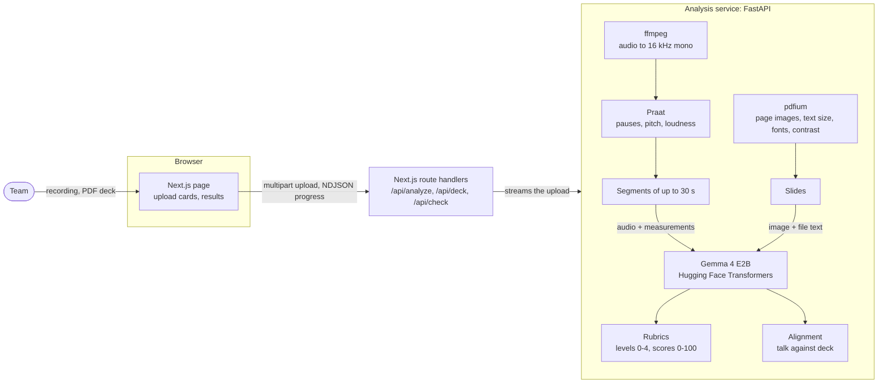

# PitchCheck

PitchCheck gives hackathon and startup teams feedback on a pitch before a human reviewer sees it. A team uploads the recording of their pitch and the slide deck. Gemma analyzes both and returns a score for the slides, a score for the pitch, and concrete feedback on what to improve.

Built for the GDG Belgrade DevFest hackathon, whose theme is "Reimagine the Event Experience with Gemma".

> **Status on 11 October 2026.** The app takes a recording of the pitch and the deck as a PDF. Gemma 4 E2B listens to the recording in segments of up to 20 seconds and reads every slide. It returns a pitch score, a slide score, insights and feedback, and a report on whether the talk follows the deck. The first version ran end to end with the real model, on synthetic material only: a text-to-speech voice and a deck made for the test. The scores now follow a stricter rubric built on Y Combinator's advice to founders (branch `feature/yc-rubric`); its new Gemma step, the checklist, came back empty in the first run with the real model and was rewritten; the rewritten step has not run with it yet. Whether Gemma reliably hears tone of voice has not been tested on real recordings, and the rubrics have not been tried on real pitches. See [What is implemented](#what-is-implemented) and [TODO.md](TODO.md).

The page has one workspace with two upload cards. Each card runs its own check, and the "Check pitch + deck" button below them runs both and compares them. Selected recordings appear as compact file cards without a video preview. Results show up to five main metrics, including the pitch and slide scores; "SHOW MORE" opens the full reports and verdict downloads in a modal. The event time-limit field hides once the pitch result is available. Design notes and component specifications for the landing page are in `docs/research/`.

## Requirements

These four are fixed.

1. **Input is a pitch video and the slide deck.**
2. **Gemma does the analysis.** Every score and every piece of feedback comes from a Gemma model.
3. **The pitch is judged from its sound, not from a transcript.** Tone, emotion, energy and pacing live in the audio signal, and a transcript drops them. The audio itself goes into the model. The feedback describes how the delivery sounds (pace, pauses, filler words, pitch, loudness); it does not label the speaker's emotions or state of mind.
4. **Output is two scores plus guidance:** a score for the slides, a score for the pitch, insights (what the analysis found) and feedback (what to change).

The scores describe the deck and the delivery. They do not rate the business idea or its investment potential.

## What is implemented

Read from the code on the `feature/yc-rubric` branch. "Implemented" means it runs end to end with the real model, except where a row says it has not yet; none of it has been validated on real pitches.

| Capability | State |
| --- | --- |
| Upload an audio or video recording; for video the audio track is extracted with ffmpeg | Implemented |
| Live progress while the analysis runs | Implemented |
| Pitch and loudness variation, measured from the signal with Praat | Implemented; sent to Gemma as supporting evidence |
| Pauses, measured from the signal with Praat | Implemented |
| Splitting the audio into segments of at most 20 seconds, cut at pauses | Implemented. Gemma accepts up to 30 seconds, but of a 27-second segment it returned only the first two thirds of what was said |
| Speaking rate, measured from the signal as syllables per second of speaking | Implemented; tried on one synthetic voice at three speeds |
| Gemma 4 E2B listens to each segment: tone of voice, filler words, and the statements the speaker makes | Implemented; not yet validated on real recordings (TODO section 1) |
| Checklist for the pitch: Gemma gets the statements it heard as a numbered list and labels each with what it says: what the company does, one of the eight expected topics, or none | Second version. The first, which asked for the statements behind each topic, came back empty with the real model; this one has not run with it yet |
| Gemma 4 E2B writes the insights and the timestamped feedback from the rated findings, lowest level first | Implemented in the first version; the prompt changed and has not run with the real model since |
| Pitch score from nine rubric criteria in two groups, content (opening, topic coverage, numbers, plain language) and delivery (pace, filler words, pauses, pitch variation, loudness), on levels 0 to 4, every level given in code | Written and checked without the model, on the observations saved from a real run; the rubric (`RUBRIC` in `services/audio/app/main.py`) has not been tried on real recordings |
| Time criterion: the length of the recording against the event's time limit, when the team enters one | Implemented |
| PDF deck upload; pages rendered to images; text size, words per slide, fonts, contrast, where the largest text sits and the size of the title measured from the file | Implemented; needs a PDF with a text layer for the measurements. PPTX is not accepted |
| Gemma 4 E2B reads each slide: title, main point, one point or several, key points, legibility | Implemented |
| Checklist for the deck: the same labels over the titles and key points Gemma read, by slide | As for the pitch |
| Slide score from eleven rubric criteria in two groups, content (title slide, topic coverage, numbers, plain language) and design (one message per slide, words per slide, text size, contrast, key text at the top, visual consistency, deck length), on levels 0 to 4, every level given in code | Written and checked without the model, on the test deck and the observations saved from a real run; the rubric (`RUBRIC` in `services/audio/app/deck.py`) has not been tried on real decks |
| Results in two steps: each card shows the score, the score of each group and the first three things to fix; "Show more" opens the criteria with the standard behind each, the checklist with the statement found for each topic, the insights, the measurements, the timeline and the slide notes | Implemented |
| Check that the spoken pitch follows the deck: deck points the talk never explains, statements where the two disagree, recommendations | Implemented (`services/audio/app/alignment.py`); a report next to the two scores, not part of either. Reading the slides word for word is not checked |
| Verdict for the organizer: after a combined check the team downloads a verdict (both scores, the level behind each criterion, a two-sentence summary, a fingerprint of each file) and a proof that opens the fingerprints | Implemented; see [Verdict](#verdict) |
| `/verify`: the organizer checks a verdict against the files a team shows and against this installation's setup | Implemented in the browser. Comparing the scores means running the files through the main page by hand |
| "See a sample result": shows a saved result without running an analysis | Out of order on this branch. `public/sample-check.json` is a real run of the combined check on the test recording and the test deck, made with the first rubric; the page does not show a result of another rubric and says the sample could not be loaded. It needs a new run with the service of this branch |
| Results stay on the page across a reload of the tab | Implemented with `sessionStorage`; the files themselves have to be chosen again |

Whisper and the wav2vec2 emotion classifier have been removed. Every judgement and every piece of feedback comes from Gemma; Praat and the PDF supply measurements only.

### How the scores are built

Each score comes from a rubric: a list of criteria, each with a description for every level from 0 to 4. Since 11 October 2026 the rubrics follow Y Combinator's published advice to founders, and they are stricter than the first version: on the test pair, the pitch went from 90 to 65 and the deck from 75 to 60 when the saved observations were rated again (with a stand-in for Gemma's checklist answers, so those two numbers show the arithmetic, not a run of the model).

The criteria sit in two groups, and the score is arithmetic over the levels, in steps of 5.

| Score | Group | Criteria |
| --- | --- | --- |
| Pitch | Content, 60% | Opening (says what the company does in the first 20 seconds), topic coverage (counts three times), numbers (market and traction stated with a number; counts twice), plain language |
| Pitch | Delivery, 40% | Pace, filler words, pauses, pitch variation, loudness, and time when the team enters the event's limit |
| Slides | Content, 50% | Title slide (the first slide says what the company does), topic coverage (three times), numbers (twice), plain language |
| Slides | Design, 50% | One message per slide, words per slide, text size, contrast, key text at the top, visual consistency, deck length |

The expected topics are the questions Y Combinator tells founders to answer: problem, solution, market, traction, unique insight, business model, team and the ask. A criterion that cannot be rated drops out of its group. A group with nothing rated leaves no score, so a pitch is never scored on delivery alone.

**Code gives every level.** Gemma supplies what is counted. It listens to each segment and reads each slide, and then gets the statements it heard or read back as a numbered list and gives each one a label: the expected topic the statement says, or none. A topic with no statement counts as missing, and market and traction count as stated with a number only when a statement about them carries one. What counts for a topic is always something Gemma heard or read. When no statement gets a label at all, the reply is treated as unusable and there is no score, so that a failed reply does not pass for a pitch that says nothing. Gemma then writes the insights and the feedback from the rated findings.

Two things led here. Gemma did not apply numeric limits reliably when asked to: it rated 5.7 filler words a minute as "5 or fewer", and a pitch with two expected topics missing as complete. And a level given from an impression is the less steady kind of judgement: CheckEval (Lee et al., EMNLP 2025, [arXiv:2403.18771](https://arxiv.org/abs/2403.18771)) reports that splitting a criterion into yes-or-no questions raised agreement between evaluator models and lowered the variance of their scores. In the first version Gemma gave three levels itself (structure of the pitch, structure and visual consistency of the deck); those criteria are now counts.

**What the first run with the real model showed.** On 11 October 2026 the combined check ran on a Kaggle T4 with the test recording and the test deck, in 5 minutes 18 seconds. Gemma heard and read the statements as before. The checklist was then asked the other way round, "for each topic, give the numbers of the statements that say it", and it came back empty for all nine items, for the pitch and for the deck. With every topic counted as missing the pitch scored 45 and the deck 40, which is wrong: both say most of the topics. That prompt showed the shape of the reply with empty lists, and the reply was not kept, so whether Gemma gave the shape back is a guess.

The question is now a label for each statement, the kind Gemma answered sensibly in the first version when it named the topics of each segment. The shape in the prompt cannot pass for an answer, and every statement comes back in the result with its label (`labelled` in the summary), so a wrong label can be seen.

**What is not tested.** The labelling prompt has not run with the real model yet, so it is still not known how well Gemma 4 E2B sorts the statements. Nothing has been tried on a real pitch or a real deck.

#### Where the standards come from

Read on 11 October 2026. Each result shows, next to every criterion, the sentence it rests on and what level 4 takes.

| Source | What the rubrics take from it |
| --- | --- |
| Michael Seibel, [How to Pitch Your Company](https://www.ycombinator.com/library/4b-how-to-pitch-your-company) | The seven questions a pitch answers; "eliminate jargon, acronyms, marketing speak, and any ambiguous terms such as 'platform'" |
| Geoff Ralston, [A Guide to Demo Day Presentations](https://www.ycombinator.com/blog/guide-to-demo-day-pitches) | Say what you do first; the problem and the product; bottom-up numbers; speak slowly, pause, no monotone, project; one point per slide, few words, important text at the top |
| Aaron Harris, [How to build your seed round pitch deck](https://www.ycombinator.com/library/2u-how-to-build-your-seed-round-pitch-deck) | The slides of a seed deck, from the title slide with a one-line description to the ask; "Make the numbers clear and meaningful" |
| Kevin Hale, [How to design a better pitch deck](https://www.ycombinator.com/library/4T-how-to-design-a-better-pitch-deck) | Legible, simple, obvious: large type, good contrast, one idea per slide |

Y Combinator gives almost no numbers, so the limits that turn a standard into levels are this team's choice, and the code says so next to each one. Three limits come from elsewhere: the filler word levels end at the two rates one study tested (Laske and DiGennaro Reed 2024, in English: 5 a minute did no harm, 12 did), the contrast limit is WCAG 2.2, and the smallest text is 24 pt on a standard slide, the minimum [Penn State's accessibility guidance](https://accessibility.psu.edu/legibility/fontsize) gives for slides projected to an audience. Visual consistency is not in Y Combinator's guides at all; it is kept from the first version of the rubric.

What changed in the limits: a slide is marked from 40 words (was 60) and from text under 24 pt (was 18 pt), a segment counts as fast from 5.0 syllables a second (was 5.5), filler words reach the top level at 2 a minute (was 5), and a pitch with fewer than 3 pauses a minute is marked. The shares of marked slides, or of marked time, that separate the levels are 10%, 25% and 50%; they were 15%, 35% and 60% for slides and 20%, 50% and 100% for time.

Plain language is a count of marketing and jargon words from a short fixed list (`BUZZWORD` in `services/audio/app/rubric.py`), in English only. It marks "platform" and "AI-powered"; it does not recognise jargon that is not on the list.

### What Gemma did not hear

One test, on 11 October 2026, with a text-to-speech voice. The same 56 words were spoken at three rates: 124, 169 and 343 words a minute. Gemma 4 E2B got each clip through the per-segment prompt, once with the audio alone and once with the signal measurements in the prompt.

| Clip | Gemma's pace, audio alone | Gemma's pace, with measurements | Measured speaking rate |
| --- | --- | --- | --- |
| 124 words a minute | conversational | conversational | 3.49 syllables a second |
| 169 words a minute | conversational | conversational | 4.23 syllables a second |
| 343 words a minute | conversational | conversational | 7.05 syllables a second |

Gemma's description of the tone was nearly the same sentence for all three clips, and it listed the word "like" in "like tiny fonts" as a filler word every time. So pace is no longer asked of Gemma. It is measured from the signal: syllables are counted as voiced peaks in loudness (de Jong and Wempe 2009) and divided by the seconds of speaking. A segment under 2.7 syllables a second counts as slow and one over 5.0 as fast. Those limits are a convention: on a line through the three clips above they are about 75 and 215 words a minute for this voice, and they have not been checked on human voices. The fast limit is the tighter one because Y Combinator's advice is to speak slowly.

The test says nothing about tone: a synthetic voice at three speeds does not change its tone. Whether Gemma hears flat against lively delivery is still open, and it needs human recordings (TODO section 1).

Pauses, pitch variation and loudness had been rated by Gemma from the sound and the measurements in its prompt. On the same steady synthetic voice it gave loudness level 3 in one run and level 2 in the next. Those three are now rated in code as well, from the measurements alone, with limits the team chose: a pause over 2 seconds is long, a segment whose pitch varies by under 2 semitones is even, a segment 6 dB quieter than the whole recording is quiet, and a segment whose loudness swings by over 9 dB is uneven. None of the four has a study behind it. What Gemma does for the pitch is hear the filler sounds and the statements, say which statements explain each expected topic, and write the insights and the feedback from the rated findings.

Only sounds that fill a pause (um, uh, er, hmm) are counted as filler words. Gemma also listed words such as "like" and "so" where they were part of the sentence, so words are left out of the count.

The rubrics rate what is said and what can be heard, seen or measured. They have no criterion for emotion, confidence, accent or pronunciation, and the results cards say so. Y Combinator's advice also covers things the product cannot see or hear in its input, such as facing the audience, standing still and practising; those are left out. Where each standard and each limit comes from is in "Where the standards come from" above, in the code, and next to every criterion on the results cards.

## Architecture



The only AI model is Gemma 4 E2B, a Google open model, run locally through Hugging Face Transformers. One model instance serves audio, slide images and text, and one analysis runs at a time.

## Verdict

An event can ask for the result of the check and not for the recording or the deck. After a combined check the results page offers two files.

- **The verdict** goes to the organizer. It holds both scores, the level and the reason for each criterion, the two-sentence summary of what the team builds, how much of the deck the talk covers, and the setup that produced it (model, dtype, and a hash over the service's code, which contains every prompt, rubric and limit). It does not hold the feedback, the timeline, the slide notes or the files.
- **The proof** stays with the team. It holds two random salts.

For each file the verdict carries SHA-256(salt + file). The salt is random per analysis and is made by the service, so the fingerprint says nothing about the file, and the same deck gives a different fingerprint every time. When the organizer asks a finalist to show the recording and the deck, the team hands over the proof with them, and `/verify` checks in the browser that these are the files the verdict was made for and that the verdict came from the same setup as the organizer's installation. The organizer can then run the files through the main page and compare the scores.

What this does and does not give:

- It makes a swapped file or a verdict for another file show up at the check. It does not stop a team from editing a verdict; an edited score shows up only when the organizer re-runs the analysis.
- Scores from a re-run are expected to be close, not always identical: the same model can give different levels on different hardware or dtype. How wide that band is on real hardware has not been measured.
- It does not show which of several attempts a team handed in.
- The verdict is not anonymous: the summary says what the team builds.

None of this is cryptographic proof of an honest analysis, and the app does not call it that.

## Pipeline

All seven steps are built, shaped by the Gemma limits in the next section.

1. The team uploads the pitch video and the deck as a PDF.
2. ffmpeg extracts the audio track as 16 kHz mono.
3. The audio is split into segments of at most 20 seconds. Gemma accepts clips of up to 30 seconds; shorter ones made it keep all of what was said.
4. For each segment, Gemma receives the audio together with signal measurements for that segment (pitch variation, loudness variation, speaking rate, pauses). It returns structured observations about delivery (tone of voice, filler words) and the statements the speaker made.
5. Deck pages are rendered to images and measured from the file. Gemma reads each page image, with the page's text from the file, for its title, its point and its key points.
6. For the pitch and for the deck, Gemma gets the statements it heard or read as a numbered list and labels each with the expected thing it says, or with none. Code gives every level from that and from the measurements, and the two scores come out of the rubrics. Gemma then writes the insights and the feedback from the rated findings.
7. Gemma compares the key points of the slides with the key points of the speech: deck points the speaker never explained, and statements that contradict the slides. Summarizing a slide or adding explanation is not a finding.

The analysis service has one endpoint for each use: `/analyze/stream` for a recording, `/deck/stream` for a deck, and `/check/stream` for both with the comparison.

## What the Gemma documentation confirms

Checked on 10 October 2026.

| Fact | Consequence for PitchCheck |
| --- | --- |
| Audio input exists in Gemma 3n and in Gemma 4 E2B, E4B and 12B Unified. Gemma 4 26B A4B and 31B do not take audio. | The model must be one of the audio-capable variants. Gemma 4 E2B is the default (`GEMMA_MODEL`). |
| One audio clip is at most 30 seconds, 16 kHz, single channel, 25 tokens per second in Gemma 4. | A pitch of several minutes has to be segmented and the results combined. |
| Documented audio tasks are speech recognition and speech translation. Emotion, tone and prosody are not mentioned as a capability or as a limitation. | Requirement 3 depends on behavior the documentation does not promise. It has to be tested on real recordings first. |
| Video is processed as image frames, up to 60 seconds at one frame per second. | Video frames are not part of the plan; the recording is used for its sound. |
| Image input covers document and PDF parsing, OCR and chart comprehension, with a visual token budget of 70 to 1120 per image. | Slides can be sent as page images. |
| Gemma 4 is released under Apache 2.0. | No license obstacle to local use. |

Sources: [Gemma 4 model card](https://ai.google.dev/gemma/docs/core/model_card_4) (updated 30 July 2026), [Gemma audio understanding](https://ai.google.dev/gemma/docs/capabilities/audio) (updated 10 October 2026), [Welcome Gemma 4](https://huggingface.co/blog/gemma4) on Hugging Face.

The only official code example for audio uses Hugging Face Transformers (`AutoProcessor` with `AutoModelForMultimodalLM`). Third-party guides report that recent Ollama versions accept audio for Gemma 4 and that llama.cpp does not; neither claim was checked against an official source.

## Running it

With Docker:

```bash
docker compose up --build
```

The web app is on http://localhost:3000 and the audio service on http://localhost:8000. The first start downloads the Gemma weights (several GB), which can take a while. If Hugging Face asks for the Gemma license to be accepted, export `HF_TOKEN` before starting.

From prebuilt images, on a machine that should not build them: every push to `main` publishes both images to GitHub Container Registry (`.github/workflows/images.yml`) for `linux/amd64` and `linux/arm64`, so they run natively on x86 machines and on Apple Silicon. The images are public, so no login is needed. Copy `docker-compose.yml` over, and pull:

```bash
docker compose pull
docker compose up -d
```

Images are tagged `latest` and `sha-<short commit>`; set `TAG=sha-abc1234` to run a specific build. Try Gemma on one clip with `docker compose exec audio python -m scripts.probe <file>` after copying the file into the container (`docker compose cp clip.wav audio:/tmp/clip.wav`). Add `--audio-only` to leave the signal measurements out of the prompt and see what Gemma hears on its own.

If the app does not start, check `docker compose ps -a` and
`docker compose logs --tail=100 audio`. The web container waits for the audio
service to become healthy. Older audio images can fail with
`AnyToAnyPipeline requires the librosa library`; the dependency is now included
in `services/audio/requirements.txt`. To repair a pulled image from this checkout:

```bash
docker compose build audio
docker compose up -d --no-build --pull never
```

This keeps the downloaded model weights in the `models` volume. Pulling again
replaces the local image, so use the repaired image until an updated image is
published to the registry. Startup readiness confirms that Gemma loaded; it does
not verify the quality or speed of pitch analysis.

If analysis stays at **5% / Gemma is listening**, that percentage does not move
until the first audio segment finishes. Check `docker compose logs -f audio`:
the service logs the segment and the time for each Gemma call. `/health` also
reports `analysis_running` and `model_devices`. Only one analysis runs at a time;
another request receives HTTP 429 instead of competing for model memory.
Generation logs report the time to the first output token, progress every 32
output tokens, and the final token count. A long wait for the first token points
to input processing; slow progress afterward points to text generation. These
diagnostics log counts and timings, not the model's text or the recording.

On a machine with enough available RAM, set `GEMMA_DEVICE_MAP=cpu` in `.env`
and recreate the audio container with `docker compose up -d --no-build --pull never`.
This keeps the full model in RAM instead of automatically offloading layers to
disk. E2B has roughly 10.2 GB of weights and needs additional memory for inference;
do not use this setting on a Docker VM with too little RAM. The default remains
`auto` for other machines. Docker on this Mac runs CPU-only inference.

A local diagnostic on an Apple M5 with 16 GB RAM and a Docker VM with 11.67 GiB
used one second of silence and at most eight output tokens: automatic CPU/disk
placement took 22.4 s; full CPU placement took 7.5 s. This is a short inference
benchmark, not a delivery-quality test or an end-to-end pitch timing. Start with
one short spoken clip and wait for it to finish before submitting another.

On 11 October, a roughly 24-second spoken recording reached the scoring stage:
the first Gemma audio call completed in 480 s and its JSON parsed on the first
attempt. The browser advanced from 5% to 90%. This run overlapped an audio-image
rebuild, so the timing includes competing build work. It confirms that waiting
at 5% can be slow inference rather than a failed request; it does not establish
delivery accuracy or a clean performance baseline.

Without Docker, in two terminals:

```bash
pnpm install
pnpm dev
```

```bash
cd services/audio
pip install -r requirements.txt
uvicorn app.main:app --port 8000
```

The audio service needs Python 3.12 and ffmpeg on the PATH. The web app reaches it through `AUDIO_SERVICE_URL`, which defaults to `http://localhost:8000`.

If `pnpm dev` keeps serving old styles or old code after a `git pull`, the dev server missed a file change. That happened with the repository inside a OneDrive folder on Windows: files replaced on disk, as git and some editors do, were not noticed until a restart. Put `NEXT_WATCH_POLL_MS=1000` in `.env.local` to make the dev server poll for changes. Polling costs CPU, so leave it off where file events work.

`GEMMA_DTYPE` sets the dtype the model is loaded in. The default `auto` uses the checkpoint's bf16; GPUs without bf16, such as the T4, need `float16`.

On a Kaggle GPU, for a laptop that cannot run Gemma: import `notebooks/kaggle.ipynb` into Kaggle, follow its first cell (GPU, Internet, `HF_TOKEN` secret) and run all cells. It clones the branch named in `BRANCH` (default `main`) from GitHub, starts the audio service and prints a Cloudflare tunnel URL. Run the web app locally against it:

```bash
AUDIO_SERVICE_URL=https://<printed-url> pnpm dev
```

The page and the service have to be the same version: the page shows an error instead of results when the service behind it is older. With the Kaggle service the recording and the deck leave the laptop, through the tunnel, to Kaggle; that setup is for demonstrations on a machine that cannot run the model.

`SLIDE_TOKENS` sets the visual tokens Gemma spends on one slide (70, 140, 280, 560 or 1120; default 560): more reads small text better and takes longer. `MAX_SLIDES` (default 20) caps how many pages of a deck are analyzed. `PITCH_TOPICS` replaces the eight expected topics with an event's own, as a JSON object of name to meaning, for example `{"problem": "what hurts, and for whom", "go-to-market": "how it reaches buyers"}`; both rubrics use it. The numbers criterion looks at the topics named `market` and `traction`, and is not rated when an event's list has neither. `SEGMENT_SECONDS` (default 20, at most 30) sets the longest audio segment.

On one machine the results of the first rubric repeated. On the laptop CPU the test recording gave the same levels, score, statements and feedback text in two runs, and the test deck the same levels and score in four. This has not been measured again since the rubric changed. Across machines they can differ; that has not been measured.

Measured on one laptop CPU (16 threads, 12 GB for the Docker VM, bf16 weights): a 31-second recording takes about 4 minutes, an 8-slide deck about 13 minutes at 50 to 80 seconds per slide, and the combined check of a one-minute recording with that deck took 16 to 19 minutes in five runs. On a Kaggle T4 the 31-second recording took 64 seconds, and the combined check of the one-minute recording with the 8-slide deck took 5 minutes 18 seconds under the new rubric. These are single runs on one machine, not benchmarks.

## Repository layout

| Path | Contents |
| --- | --- |
| `src/app/page.tsx` | The landing page |
| `src/components/pitch-workspace.tsx` | Owns the two files, runs the three checks and lays out the results |
| `src/components/analysis-overview.tsx`, `analysis-overview.css` | Compact results overview and modal with the full reports and verdict downloads |
| `src/components/audio-analyzer.tsx`, `deck-uploader.tsx`, `combined-pitch-check.tsx` | The recording card, the deck card and the combined button |
| `src/components/pitch-results.tsx`, `deck-results.tsx`, `alignment-results.tsx` | The results views |
| `src/components/verdict-card.tsx`, `src/lib/verdict.ts` | Builds and downloads the verdict and the proof after a combined check |
| `src/app/verify/page.tsx`, `src/components/verdict-checker.tsx` | The organizer's page: checks a verdict against the files a team shows |
| `src/app/api/analyze`, `api/deck`, `api/check` | Route handlers; each streams the upload to the analysis service through `src/lib/proxy-upload.ts` and relays its progress events |
| `src/app/api/health` | The analysis service's status and setup, for `/verify` |
| `src/lib/analysis.ts` | Types for the analysis results and progress events |
| `services/audio/app/main.py` | FastAPI service: loads Gemma, analyzes the recording (decode, measure, split, Gemma per segment, pitch rubric) and serves the endpoints |
| `services/audio/app/deck.py` | Deck analysis: PDF rendering and measurements, Gemma per slide, deck rubric |
| `services/audio/app/alignment.py` | Compares the key points of the slides with the key points of the speech |
| `services/audio/app/rubric.py` | Shared by both rubrics: the expected topics, the sources of the standards, the checklist prompt and its validation, the list of marketing words, the 0 to 100 score |
| `services/audio/scripts/probe.py` | Runs the per-segment Gemma prompt on one clip of 30 s or less, with or without the signal measurements, for testing what Gemma hears |
| `services/audio/scripts/smoke_test.py` | Runs the service end to end with a tiny random Gemma 4; CI runs it in the audio image before tagging |
| `docker-compose.yml` | The `web` and `audio` services |
| `notebooks/kaggle.ipynb` | Runs the audio service on a Kaggle GPU behind a Cloudflare tunnel |

## Privacy

PitchCheck is privacy first: a startup should not have to send its idea to someone else's server to get feedback. For competitions, the web app, the analysis service and Gemma all run on the organizer's server, and recordings and decks are never sent to an outside AI provider. The landing page states this beside the upload cards, in the FAQ and in the footer.

The recording and the deck go from the browser to the analysis service named in `AUDIO_SERVICE_URL` and nowhere else. The service keeps them in memory and in a temporary file for the length of one analysis and stores nothing afterwards. With Docker Compose both services run on the same machine, and the only outside traffic is the download of the model weights from Hugging Face on first start.

The Kaggle notebook is a development option: with it the files leave the machine. Competition deployments must run the analysis service and Gemma on the organizer's server to keep the privacy promise. On a laptop CPU the model fits in 12 GB but a full check of a pitch and a deck takes tens of minutes, so the organizer's server needs a GPU to make the wait short.
