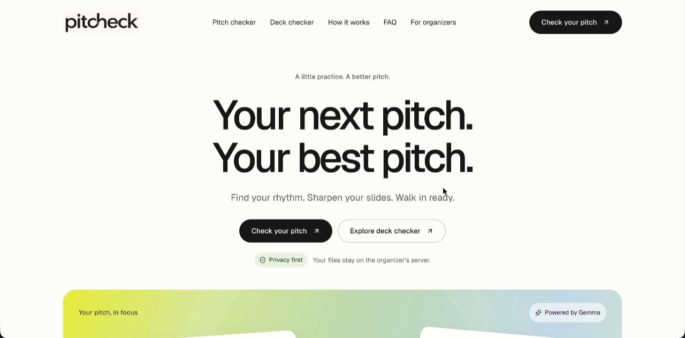
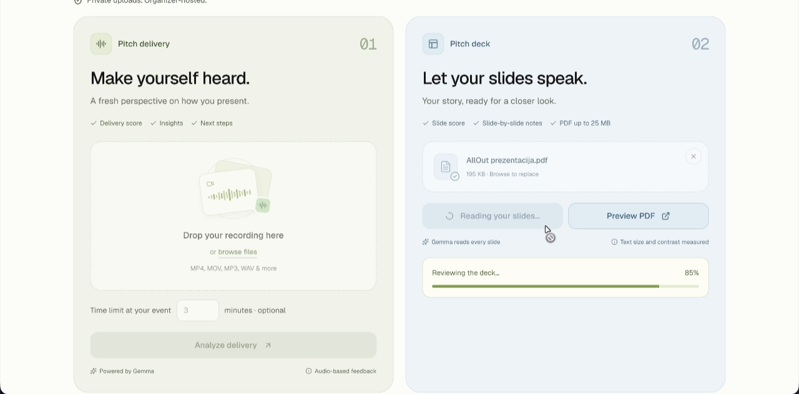
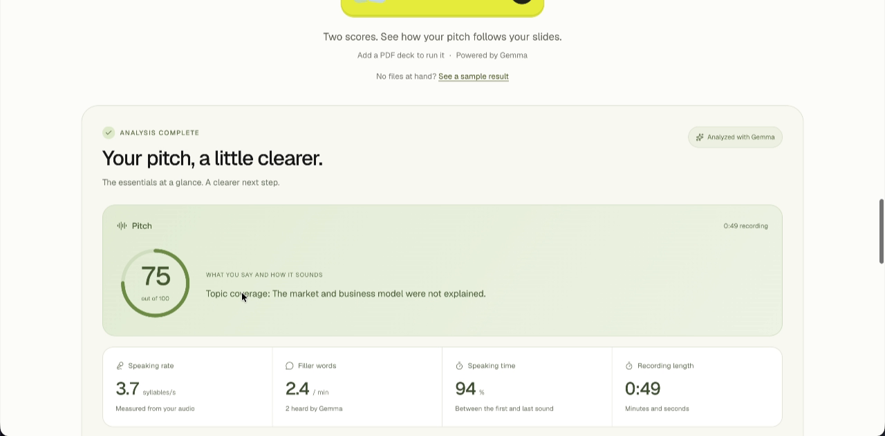
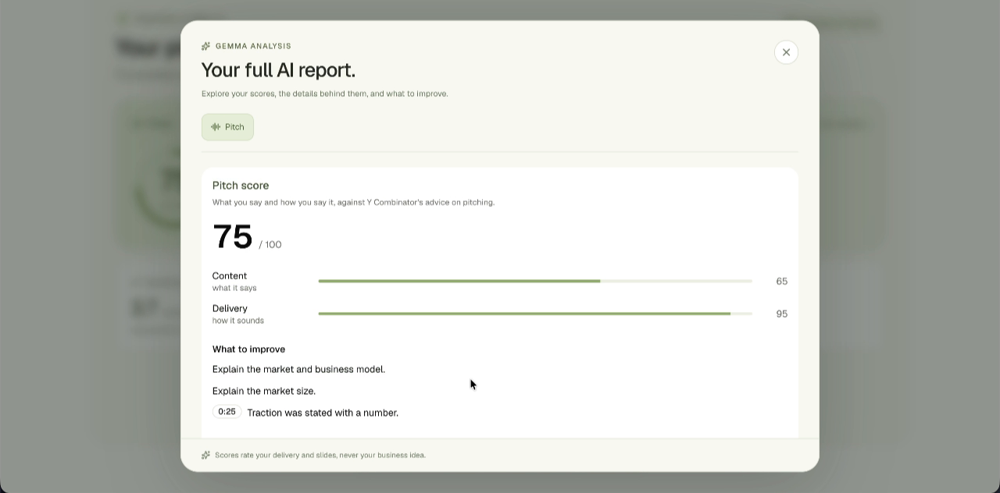
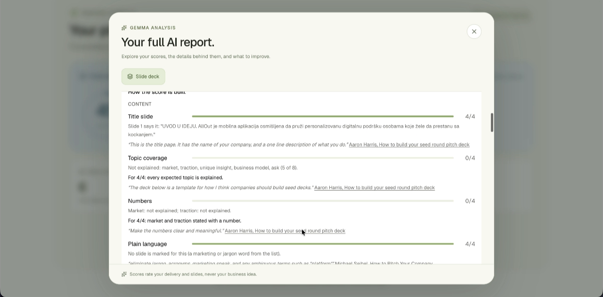
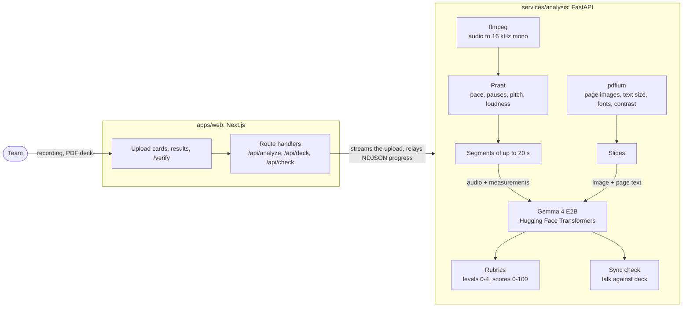

# PitchCheck

**A privacy-first pitch checker for founders and event organizers, powered by Gemma 4.**

🥉 **3rd place at the GDG Belgrade DevFest 2026 hackathon**, theme "Reimagine the Event Experience with Gemma".

A team uploads the recording of its pitch and its slide deck. Gemma 4 listens to the delivery, reads every slide and checks that the talk follows the deck. The team gets back a pitch score, a slide score, and concrete, timestamped feedback, all before a human reviewer sees the pitch. Everything runs on the organizer's own server, so no idea is sent to a third-party AI service.

**▶ Demo video:** [youtu.be/nCDLS87LJr8](https://youtu.be/nCDLS87LJr8) · **Pitch deck:** [docs/pitch-deck.pdf](docs/pitch-deck.pdf)



## The problem

Organizers spend hours on repetitive checks of last-minute pitches, right before deadlines. Founders get no quick feedback on their slides or on how their delivery sounds. In our survey, 10 of 14 respondents called this a big problem.

## Three checks

| Deck check | Pitch check | Sync check |
| --- | --- | --- |
| Title slide, expected topics, numbers, plain language | Opening, expected topics, numbers, plain language | Deck points the speaker never explained |
| One message per slide, words per slide, text size, contrast, key text at the top, deck length | Pace, filler sounds, pauses, pitch variation, loudness | Statements that contradict the slides |
| Feedback by slide number | Feedback with timestamps, and time against the event's limit | Recommendations |

The rubrics follow Y Combinator's published advice to founders. Scores rate the **deck and the delivery, never the business idea**. The pitch is judged from the audio signal itself, not from a transcript. PitchCheck describes how the delivery sounds and does not label the speaker's emotions.

After a combined check, a team can download a **verdict** for the organizer: both scores and a salted fingerprint of each file. On `/verify` the organizer can later check that a finalist shows the same files. See [docs/verdict.md](docs/verdict.md).

<table>
  <tr>
    <td></td>
    <td></td>
  </tr>
  <tr>
    <td></td>
    <td></td>
  </tr>
</table>

## How it works



1. ffmpeg extracts the audio track. Praat measures pace, pauses, pitch and loudness from the signal.
2. The audio is cut at pauses into segments of up to 20 seconds. Gemma listens to each segment and reports the filler sounds and the statements made.
3. Each slide is rendered to an image and measured from the PDF. Gemma reads the slide's title, its point and its key points.
4. Gemma labels each statement and each slide with the expected topic it covers. Code turns those counts and the measurements into rubric levels, and Gemma writes the insights and the feedback.
5. Gemma compares the slides with the talk.

Gemma 4 E2B is the only AI model on the analysis path. The full write-up covers the pipeline, the scoring, where every standard comes from and what Gemma could and could not hear: see [docs/how-it-works.md](docs/how-it-works.md).

## Quick start

```bash
cp .env.example .env      # optional: HF_TOKEN, model, limits
docker compose up --build
```

The web app runs on http://localhost:3000 and the analysis service on http://localhost:8000. The first start downloads the Gemma weights, which are several GB.

To run it without Docker, from prebuilt images, or on a Kaggle GPU, and for troubleshooting, see [docs/deployment.md](docs/deployment.md).

## Repository layout

| Path | Contents |
| --- | --- |
| `apps/web` | Next.js app: the landing page, upload workspace, results, `/verify`, and the API routes that proxy to the analysis service |
| `apps/web/src/lib` | Result types, streaming upload proxy, verdict building, results store |
| `apps/web/tests` | Node tests for the client side of the analysis stream (`pnpm test`) |
| `services/analysis/app/main.py` | FastAPI service: loads Gemma, analyzes the recording and serves `/analyze/stream`, `/deck/stream`, `/check/stream` and `/health` |
| `services/analysis/app/deck.py` | Deck analysis: PDF rendering and measurements, Gemma per slide, deck rubric |
| `services/analysis/app/alignment.py` | Sync check between the slides and the speech |
| `services/analysis/app/rubric.py` | Expected topics, sources of the standards, the labelling checklist, the 0–100 score |
| `services/analysis/scripts` | `probe.py` tries the segment prompt on one clip; `smoke_test.py` runs the service end to end with a tiny random Gemma (CI) |
| `notebooks/kaggle.ipynb` | Runs the analysis service on a Kaggle GPU behind a Cloudflare tunnel |
| `docs/` | Pitch deck, technical write-up, deployment, verdict, limitations, design notes |

## Privacy

A startup should not have to send its idea to someone else's server to get feedback. In a competition deployment, the web app, the analysis service and Gemma all run on the organizer's server. The recording and the deck go from the browser to the analysis service and nowhere else. They are held in memory and in a temporary file for one analysis, and nothing is stored afterwards. The only outside traffic is the one-time download of the model weights from Hugging Face. The Kaggle notebook is a development option, and with it the files do leave the machine.

## Status

PitchCheck is a hackathon project. It runs end to end with the real model, but only on synthetic test material. The rubrics have not been validated on real pitches, and whether Gemma hears tone of voice is still untested. See [docs/limitations.md](docs/limitations.md) for what is open.

## Team

- Jovan Tomović
- Darko Trifunoski
- Petar Popović
- Djordje Žerajić

## License

The code is released under the [MIT License](LICENSE). Gemma 4 is a Google model, released under Apache 2.0, and is downloaded separately at first start.
